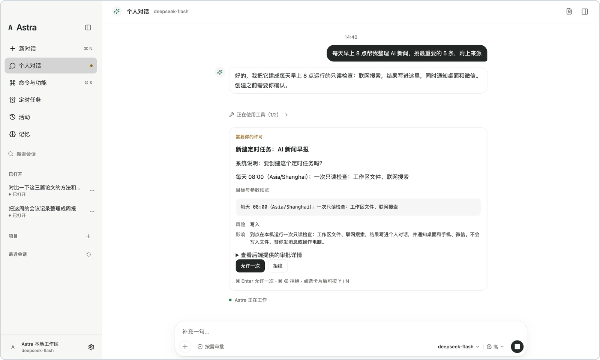
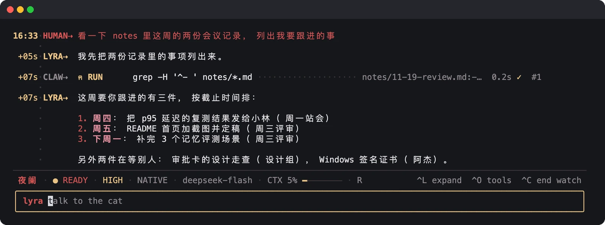

# Astra ✦

**English** · [简体中文](README.zh-CN.md)

**A personal AI agent that runs on your own computer.** Astra works in your
files, browser and apps, remembers what matters across conversations, runs
scheduled checks for you, and can be reached from WeChat, QQ or an iPhone.

Conversations, memory and history are stored on your machine. Requests go to the
model you choose: a ChatGPT or Claude subscription, an API provider or a local
endpoint. Use Astra from the terminal or from the desktop app (preview).

<picture>
  <source media="(prefers-color-scheme: dark)" srcset="docs/images/desktop-dark.webp">
  
</picture>

<sub>The desktop app asks before it creates a scheduled check. Its interface is in Chinese. Screenshots use a scripted model and sample data.</sub>

[What it does](#what-it-does) · [Quick start](#quick-start) · [How it's built](#how-its-built) · [Testing](#testing) · [Documentation](#documentation)

## What it does

| Capability | What Astra does |
| --- | --- |
| **Everyday work** | Searches the web, reads and edits files, runs code and notebooks, and writes [documents](docs/documents.md) section by section with Word, PDF or HTML export. |
| **Computer use** | Operates [browser pages](docs/browser-interaction.md) and a selected [macOS app window](docs/macos-computer-use.md). [Appshot](docs/appshot.md) brings a window's screenshot and text into your message on macOS and Windows. |
| **Memory and skills** | Keeps a small core memory you can edit, searches earlier conversations locally, and saves reusable skills for you to review. See [memory](docs/memory.md). |
| **Scheduled work** | Runs [reminders and recurring read-only checks](docs/persistent-jobs.md), such as a morning and evening news digest, and sends the results as a desktop notification or to WeChat. |
| **Mail and calendar** | Reads any IMAP mailbox without changing it, and Calendar and Reminders on macOS; adding an event or a reminder asks for your approval. |
| **Messaging and phone** | Answers in [WeChat or QQ](docs/integrations.md#native-messaging-channels). A [paired iPhone](docs/phone.md) can follow and approve the Mac's sessions. |
| **Delegation** | Hands parts of a task to named subagents. Interrupted tasks keep checkpoints and can resume. |
| **Desktop app (preview)** | Background sessions, approvals, file diffs, interactive cards and pages, and canvases for slide decks and documents. See the [desktop guide](docs/gui.md). |
| **Models and tools** | ChatGPT / Codex and Claude subscriptions, DeepSeek, Qwen, OpenRouter and other OpenAI-compatible APIs, or a local endpoint. MCP servers add tools, and a speech model can [read replies aloud](docs/voice.md). |

Lyra is Astra's default persona. For a small terminal easter egg, try `/bar`.

## Quick start

Astra is pre-release: install it from a Git checkout. You need **Python 3.11+**,
**Node.js 18+ with npm**, and **Git**.

**Windows — CMD or PowerShell**

```powershell
git clone https://github.com/ZihangHe13123/Astra.git
cd Astra
.\astra.bat setup --install-command
```

**macOS or Linux**

```bash
git clone https://github.com/ZihangHe13123/Astra.git
cd Astra
./astra.sh setup --install-command
```

Setup prepares the Python environment and the terminal UI, registers `astra` in
your user PATH and creates `.env` if needed. Existing configuration is kept.

**Connect a model.** Open a new terminal and choose one:

| To use | Connect |
| --- | --- |
| A ChatGPT / Codex subscription | Run `astra auth login` and approve the one-time code in your browser. See [subscriptions](docs/usage.md#chatgpt-and-claude-subscriptions) and [login troubleshooting](docs/codex-oauth.md). |
| A Claude subscription | Sign in to your own [Claude Code](https://code.claude.com/docs/en/setup) CLI with `claude auth login`, then choose **Claude / Claude Code → Subscription** in `/connect`. See [how the connection works](docs/usage.md#chatgpt-and-claude-subscriptions). |
| An API provider or a local model | Choose it with `/connect` inside Astra, or set it in `.env`. See [model connections](docs/usage.md#model-connections). |

**Start** in the folder you want to work in:

```text
astra doctor
astra
```



Choose a model with `/model`; `/help` lists the other commands. For the desktop
app, run `astra setup --gui` once (it needs Node.js 22.19+), then `astra --gui`.
To update, close running sessions and run `astra update`. See the
[desktop guide](docs/gui.md), [everyday use](docs/usage.md) and
[updates and recovery](docs/launcher-update.md).

## How it's built

Astra is a Python agent runtime with two clients, an Ink terminal UI and an
Electron desktop that share one TypeScript core, plus native helpers for macOS
and Windows. The terminal UI and each active desktop session run their own
backend process and exchange line-delimited JSON with it. A few rules shape
most of the code:

- **A tool call with an unknown outcome is never replayed.** Adjacent reads may
  run in parallel; writes wait for earlier work and block later reads. A call
  that started but did not return, because of a timeout or a lost connection, is
  recorded as *outcome unknown*, and its effects are checked before anything is
  tried again. See [turn reliability](docs/runtime/turn-reliability.md).
- **What was sent to the model stays as sent.** A conversation's tool list is
  fixed when it starts. Guidance and skill edits apply to new conversations or
  are appended, and display-only data never enters model history. Requests keep a
  stable prefix, so a provider's prompt cache can be reused until compaction or a
  model change starts a new one. See
  [provider reliability](docs/provider-reliability.md#system-prompt-prefix-reuse).
- **Retrieval runs locally.** Earlier conversations, recorded activity and saved
  memories are searched with SQLite full-text indexes, including one for Chinese
  and other CJK text, then merged with reciprocal-rank fusion and de-duplicated
  with MMR. An optional local embedding model adds semantic search; no hosted vector
  database is involved. See [native memory](docs/native-memory-recommendation.md).
- **Consequential actions wait for approval.** Code runs in a Docker sandbox by
  default, and file access follows explicit path rules. Under on-demand approval,
  paying, sending, deleting and publishing are asked every time, and no earlier
  approval covers them. Scheduled checks run read-only. See
  [tool execution](docs/execution.md).

The [architecture overview](docs/architecture.md) maps the processes, the
repository and the design documents.

## Testing

Tests run through real entry points with isolated state: the Python runtime and
CLI, both clients (the desktop suite drives a real Electron window) and the
Swift tests of the macOS helper. The release gate runs on macOS, Windows and
Linux. These evaluations run offline, without a model:

| Evaluation | What it checks | Command |
| --- | --- | --- |
| Turn fault replay | Scripted failures, such as a stream that ends early, truncated tool arguments, a budget that runs out during a tool, and cancellation; it checks call order, file state and unknown outcomes. | `python -m agent.evals.turn_replay` |
| Conversation replay | Persona and context invariants through compaction and session migration. | `python -m agent.evals.replay` |
| Memory | Seeded synthetic histories, scored on correct recall, abstention and what is injected into each request. | `python -m agent.evals.memory.run` |

A runner for a small SWE-bench Verified subset (`python -m agent.evals.swebench`)
measures coding work with a real model. It reports per-task results, not a
leaderboard score. The [development guide](docs/development.md) describes the
gate and the evaluations.

## Your data

Source installations keep configuration in `.env`, private state in `.astra/`
and conversations in `.sessions/`; `astra update` preserves them. Local storage
does not mean local inference: whatever a request includes is sent to the model
provider you selected. Computer use needs the relevant helper, model
capabilities and OS permissions. General native Windows app control is not
available yet; see the [platform limits](docs/appshot.md).

## Documentation

| I want to… | Read |
| --- | --- |
| Install, update or recover | [Launcher and updates](docs/launcher-update.md) |
| Connect models and use the terminal | [Everyday use](docs/usage.md) |
| Use the desktop app or a phone | [Desktop](docs/gui.md) · [Phone companion](docs/phone.md) |
| Operate a browser or a Mac app | [Browser interaction](docs/browser-interaction.md) · [macOS Computer Use](docs/macos-computer-use.md) · [Appshot](docs/appshot.md) |
| Schedule reminders and checks | [Persistent jobs](docs/persistent-jobs.md) |
| Connect WeChat, QQ, mail, MCP or web search | [Integrations](docs/integrations.md) |
| Understand memory and skills | [Memory overview](docs/memory.md) · [Skill learning](docs/skill-learning.md) |
| Configure sandboxing and file access | [Tool execution](docs/execution.md) |
| Read about the design | [Architecture overview](docs/architecture.md) |
| Develop, test or maintain Astra | [Development guide](docs/development.md) |

Every other guide is listed in the [documentation index](docs/README.md).

## License

Astra is licensed under the [MIT License](LICENSE).
Third-party dependencies and evaluation materials retain their own licenses;
see the [evaluation sources](evals/coding/README.md#sources-and-licenses).
