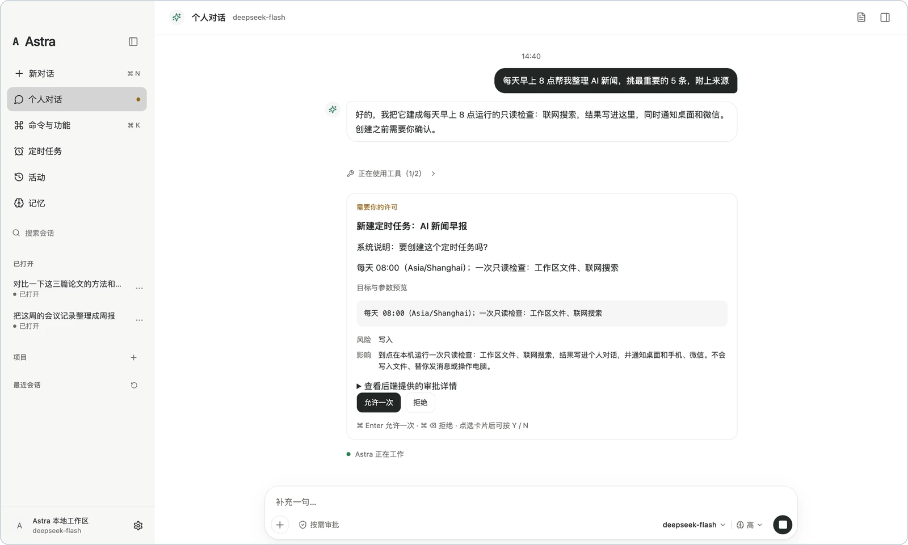
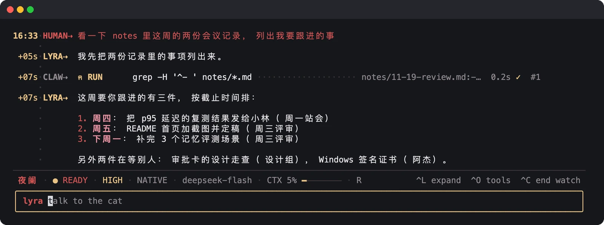

# Astra ✦

[English](README.md) · **简体中文**

**运行在你自己电脑上的个人 AI Agent。** Astra 能处理文件、操作浏览器和应用，跨对话记住重要的事，按计划替你做定时检查，也可以通过微信、QQ 或 iPhone 找到它。

对话、记忆和历史保存在你的电脑上。请求发送给你选择的模型：ChatGPT 或 Claude 订阅、API 服务，或本地模型服务。可以在终端里使用，也可以用桌面版（预览）。

<picture>
  <source media="(prefers-color-scheme: dark)" srcset="docs/images/desktop-dark.webp">
  
</picture>

<sub>桌面版在创建定时检查之前会先请你批准。截图里的模型回复和数据都是演示用的。</sub>

[能做什么](#能做什么) · [快速开始](#快速开始) · [工作原理](#工作原理) · [测试与评测](#测试与评测) · [文档导航](#文档导航)

## 能做什么

| 能力 | Astra 做什么 |
| --- | --- |
| **日常工作** | 搜索网页、读写文件、运行代码和 Notebook，逐节撰写[文档](docs/zh-CN/documents.md)并导出 Word、PDF 或 HTML。 |
| **电脑操作** | 操作[浏览器页面](docs/zh-CN/browser-interaction.md)和选定的 [macOS 应用窗口](docs/zh-CN/macos-computer-use.md)。[Appshot](docs/zh-CN/appshot.md) 在 macOS 和 Windows 上把窗口截图和界面文字带进你的消息。 |
| **记忆与技能** | 维护一份可以直接编辑的小型核心记忆，在本地检索过往对话，并积累由你检查的可复用技能。见[记忆概览](docs/zh-CN/memory.md)。 |
| **定时任务** | 运行[提醒和周期性只读检查](docs/zh-CN/persistent-jobs.md)，例如早晚各一次的新闻简报，结果以桌面通知或微信消息送达。 |
| **邮件与日历** | 只读访问任意 IMAP 邮箱；在 macOS 上读取日历和提醒事项，新增日程或提醒前会请你批准。 |
| **消息与手机** | 在[微信或 QQ](docs/zh-CN/integrations.md) 里回复你。[配对的 iPhone](docs/zh-CN/phone.md) 可以查看和审批 Mac 上的会话。 |
| **任务分派** | 把任务的一部分交给有名字的子代理。中断的任务保留检查点，可以继续执行。 |
| **桌面版（预览）** | 后台会话、审批、文件改动、交互卡片与页面，以及用于幻灯片和文档的画布。见[桌面指南](docs/zh-CN/gui.md)。 |
| **模型与工具** | ChatGPT / Codex 与 Claude 订阅，DeepSeek、Qwen、OpenRouter 等 OpenAI 兼容 API，或本地模型服务。可以接入 MCP 服务器扩展工具，也可以让语音模型[朗读回复](docs/zh-CN/voice.md)。 |

Lyra 是 Astra 的默认人格。想看终端小彩蛋，可以试试 `/bar`。

## 快速开始

Astra 目前是预发布版本，请从 Git 仓库安装。需要 **Python 3.11+**、**Node.js 18+（含 npm）** 和 **Git**。

**Windows — CMD 或 PowerShell**

```powershell
git clone https://github.com/ZihangHe13123/Astra.git
cd Astra
.\astra.bat setup --install-command
```

**macOS 或 Linux**

```bash
git clone https://github.com/ZihangHe13123/Astra.git
cd Astra
./astra.sh setup --install-command
```

安装会准备 Python 环境和终端界面，把 `astra` 注册到用户 PATH，并在缺少 `.env` 时创建它。已有配置会保留。

**连接模型。** 打开一个新终端，任选一种方式：

| 使用 | 连接方式 |
| --- | --- |
| ChatGPT / Codex 订阅 | 运行 `astra auth login`，在浏览器中输入一次性代码并批准。见[订阅连接与排障](docs/zh-CN/usage.md#chatgpt-and-claude-subscriptions)。 |
| Claude 订阅 | 先用 `claude auth login` 登录你自己的 [Claude Code](https://code.claude.com/docs/en/setup) 命令行，再在 `/connect` 中选择 **Claude / Claude Code → Subscription**。见[连接方式说明](docs/zh-CN/usage.md#chatgpt-and-claude-subscriptions)。 |
| API 服务或本地模型 | 在 Astra 内用 `/connect` 选择，或写入 `.env`。见[模型连接](docs/zh-CN/usage.md#model-connections)。 |

**启动。** 进入准备工作的文件夹，运行：

```text
astra doctor
astra
```



用 `/model` 选择模型，`/help` 查看其他命令。桌面版先运行一次 `astra setup --gui`（需要 Node.js 22.19+），之后用 `astra --gui` 启动。更新时先退出正在运行的会话，再运行 `astra update`。详见[桌面指南](docs/zh-CN/gui.md)、[日常使用](docs/zh-CN/usage.md)和[更新与恢复](docs/zh-CN/launcher-update.md)。

## 工作原理

Astra 由 Python 编写的 agent 运行时、两个共用一套 TypeScript 核心的客户端（Ink 终端界面和 Electron 桌面版），以及 macOS 和 Windows 的原生辅助程序组成。终端界面和桌面版的每个活跃会话各自运行一个后端进程，用逐行 JSON 与它通信。大部分代码遵循下面几条规则：

- **结果未知的工具调用从不自动重放。** 相邻的只读调用可以并行；写操作等之前的工作完成，并挡住之后的读取。已经开始、却因超时或断线没有返回的调用记为“结果未知”，再次尝试之前先检查它的实际效果。见[轮次可靠性](docs/runtime/turn-reliability.md)（英文）。
- **发给模型的内容保持原样。** 对话的工具列表在开始时就确定；指引和技能的修改在新对话中生效，或以追加方式加入；仅用于显示的数据不进入模型历史。请求前缀保持稳定，所以提供商的提示缓存可以持续复用，直到压缩或更换模型时才开始新的前缀。见[提供商可靠性](docs/provider-reliability.md#system-prompt-prefix-reuse)（英文）。
- **检索在本地完成。** 过往对话、活动记录和保存的记忆都用 SQLite 全文索引检索（包括面向中文等 CJK 文字的索引），再用倒数排名融合（RRF）合并、用 MMR 去除重复。可选的本地嵌入模型补充语义检索，不依赖托管的向量数据库。见[原生记忆](docs/native-memory-recommendation.md)（英文）。
- **有后果的操作要先审批。** 代码默认在 Docker 沙箱中运行，文件访问遵循明确的路径规则。在按需审批模式下，付款、发送、删除和发布每次都单独询问，之前的授权不能覆盖。定时检查以只读方式运行。见[工具执行](docs/zh-CN/execution.md)。

[架构概览](docs/architecture.md)（英文）介绍进程划分、代码目录和各篇设计文档。

## 测试与评测

测试通过真实入口和隔离的状态目录运行，覆盖 Python 运行时与命令行、两个客户端（桌面端测试会启动真实的 Electron 窗口），以及 macOS 辅助程序的 Swift 测试。发布检查在 macOS、Windows 和 Linux 上运行。以下评测离线运行，不调用模型：

| 评测 | 检查内容 | 命令 |
| --- | --- | --- |
| 轮次故障回放 | 脚本化的故障，例如流提前结束、工具参数被截断、工具执行期间预算耗尽、取消；检查调用顺序、文件状态和“结果未知”的记录。 | `python -m agent.evals.turn_replay` |
| 对话回放 | 经过上下文压缩和旧会话迁移后，人格与上下文的不变量是否保持。 | `python -m agent.evals.replay` |
| 记忆 | 在预置的合成历史上评分：能否正确回忆、该放弃时是否放弃，以及每次请求注入了什么。 | `python -m agent.evals.memory.run` |

SWE-bench Verified 小子集的运行器（`python -m agent.evals.swebench`）用真实模型衡量编程任务，报告逐题结果，不代表排行榜成绩。发布检查和各项评测见[开发指南](docs/zh-CN/development.md)。

## 数据与边界

源码安装把配置保存在 `.env`，私人运行状态保存在 `.astra/`，对话保存在 `.sessions/`；`astra update` 会保留这些数据。本地存储不代表本地推理：请求中包含的内容会发送给你选择的模型服务。电脑操作需要相应的辅助程序、模型能力和系统权限。Windows 上暂不提供通用的原生应用控制，详见[平台限制](docs/zh-CN/appshot.md)。

## 文档导航

| 我想要…… | 查看 |
| --- | --- |
| 安装、更新或恢复 | [启动与更新](docs/zh-CN/launcher-update.md) |
| 连接模型、使用终端界面 | [日常使用](docs/zh-CN/usage.md) |
| 使用桌面版或手机 | [桌面版](docs/zh-CN/gui.md) · [手机随身端](docs/zh-CN/phone.md) |
| 操作浏览器或 Mac 应用 | [浏览器操作](docs/zh-CN/browser-interaction.md) · [macOS 电脑操作](docs/zh-CN/macos-computer-use.md) · [Appshot](docs/zh-CN/appshot.md) |
| 设置定时提醒和检查 | [持久任务](docs/zh-CN/persistent-jobs.md) |
| 接入微信、QQ、邮箱、MCP 或网页搜索 | [可选集成](docs/zh-CN/integrations.md) |
| 了解记忆和技能 | [记忆概览](docs/zh-CN/memory.md) · [技能检查](docs/zh-CN/skill-learning.md) |
| 配置沙箱和文件访问范围 | [工具执行](docs/zh-CN/execution.md) |
| 了解设计 | [架构概览](docs/architecture.md)（英文） |
| 开发、测试或维护 Astra | [开发指南](docs/zh-CN/development.md) |

其他指南见[完整文档索引](docs/zh-CN/README.md)。

## 许可证

Astra 使用 [MIT 许可证](LICENSE)。第三方依赖与评测资料保留各自的许可，见[评测来源说明](evals/coding/README.zh-CN.md#sources-and-licenses)。
