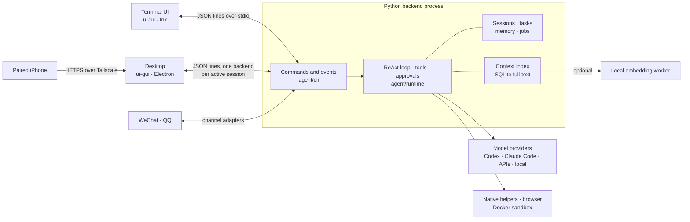

# Architecture overview

[Home](../README.md) · [Documentation](README.md)

This page shows how Astra is put together and where each part is described in
detail. The linked documents are the reference for their area; this page only
summarizes them.

## Processes

**Clients and backends.** The terminal UI starts `python -m agent.cli.backend`
and exchanges line-delimited JSON commands and events with it over stdin and
stdout. The desktop's Electron main process starts one backend per active
session with the same protocol. Its React renderer reaches the main process only
through a restricted preload bridge and holds no model logic, and browsing past
conversations does not start a model request. Both clients use `ui-core` for
protocol types, event normalization (deduplication, sequence gaps and replay
after a reconnect) and session state. The
[desktop design (Chinese)](design/gui.md) describes the desktop side in full.

**One writer per session.** A cross-process lease keyed by the data root, the
mode and the session id lets one backend write a session at a time. Another
instance can still open it read-only.

**Background host.** While the desktop is open, one more backend runs as its
background host. It serves the messaging channels, the personal thread where
scheduled results arrive, and due jobs and their notifications. Without the
desktop, the terminal backend hosts the channels itself, and `astra jobs serve`
runs due jobs into the local inbox. See [integrations](integrations.md) and
[persistent jobs](persistent-jobs.md).

**Phone companion.** It is off by default. When it is on, the desktop listens on
`127.0.0.1` only, and Tailscale serves it over HTTPS to a paired iPhone, which
runs the desktop's own interface. Models, tools and memory stay on the Mac. See
[phone companion](phone.md).

**Helpers outside the backend.**

- The macOS computer helper (Swift) provides Computer Use on one selected
  window, activity recording, and Calendar and Reminders through EventKit. See
  [macOS Computer Use](macos-computer-use.md).
- Appshot shares its capture logic between macOS and Windows adapters. See the
  [Appshot architecture](appshot-architecture.md).
- Browser control uses a CDP backend with structured page observations, or an
  extension connected through Native Messaging for your existing Edge. See
  [browser interaction](browser-interaction.md).
- Code runs in a Docker sandbox by default; host execution follows the tool
  policy and the configured file roots. See [tool execution](execution.md).
- The optional embedding worker is one local process per runtime directory and
  model, reached over authenticated loopback IPC and stopped when idle. It uses
  MLX on macOS and a llama.cpp server on Windows and Linux. See
  [Context Index platforms](context-index-platforms.md).

## Inside a backend

| Part | What it does | Reference |
| --- | --- | --- |
| ReAct loop | Keeps tool calls in dependency order, runs adjacent reads in parallel, applies turn deadlines and records unknown outcomes. | [Turn reliability](runtime/turn-reliability.md) |
| Context | Keeps canonical messages apart from provider request projections and display metadata, and keeps request prefixes stable. | [Provider reliability](provider-reliability.md) · [Core rules](runtime/core-rules.md) |
| Tools | Sends a small core set by default. Other tools reach the model as `tool_search` results and run through `call_tool` under their own names, so a conversation's tool list never changes. | [Tool execution](execution.md) |
| Approvals | Approval cards for one call, the current task or the session. Paying, sending, deleting and publishing are asked every time, and approvals inside programmatic tool calls reach the user too. | [Desktop permissions](gui.md#permissions-and-persona) · [PTC approval bridge](design/ptc-approval-bridge.md) |
| Sessions | Durable storage that keeps tool calls paired with their results, response branches and the writer lease. | [Runtime contracts](../agent/runtime/AGENTS.md) |
| Memory | Core memory files, saved records and the Context Index. | [Memory overview](memory.md) · [Native memory](native-memory-recommendation.md) |
| Subagents | Named delegates that keep their conversation between assignments. | [Subagents](execution.md#subagents) · [Worker runtime](design/worker-runtime-v1.md) |
| Jobs | Schedules, a fresh session for each run, and inbox delivery with durable receipts. | [Persistent jobs](persistent-jobs.md) |
| Providers | OpenAI-compatible APIs, ChatGPT / Codex login, the Claude Code bridge and local endpoints. | [Model connections](usage.md#model-connections) · [Codex login](codex-oauth.md) |

## Design rules

These rules come from the contributor guides (`AGENTS.md` at the repository
root and in each area) and the documents linked above.

1. **Observe unknown outcomes; never replay them.** A write that timed out or
   lost its connection may have happened. It is reported as unknown, and its
   effect is inspected before anything runs again. Jobs follow the same rule: a
   recovered run with an unknown result is not retried automatically.
2. **Keep request prefixes stable.** What was sent in a conversation is not
   rewritten for display or convenience; new guidance is appended. Explicit
   changes, compaction and revoked authority are the documented exceptions.
3. **Keep display out of model history.** Reasoning shown in a client, tool
   previews and rich rendering never change what the model is sent, and
   restoring them never runs a tool.
4. **Keep the model-facing core small.** Extending an existing tool, a CLI
   command with a skill or an optional integration comes before a new core
   tool.
5. **Give each piece of state one owner.** Sessions have leases and jobs have
   ownership locks. The clients send commands to the backend and never write
   session storage themselves.
6. **Report evidence by kind.** Mocked tests, fixture results, package checks
   and live acceptance are separate evidence and are reported separately.

## Repository map

| Path | Language | Contents |
| --- | --- | --- |
| `agent/runtime/` | Python | Agent loop, model requests, tools, context, sessions, memory and jobs |
| `agent/cli/` | Python | Backend entry point, command and event handling, terminal commands |
| `agent/ui/` | Python | Query and command services shared by the clients, such as history, activity and the memory page |
| `agent/launcher/` | Python | Setup, update and process management behind `astra` |
| `agent/channels/`, `agent/speech/`, `agent/sandbox/` | Python | Messaging adapters, voice output and execution sandboxes |
| `agent/evals/` | Python | Offline replays and evaluation runners |
| `ui-core/` | TypeScript | Shared protocol, event normalization and session state |
| `ui-tui/` | TypeScript (Ink) | Terminal client |
| `ui-gui/` | TypeScript (Electron, React) | Desktop client, background host and phone gateway |
| `native/` | Swift, C++ | macOS computer helper, Appshot core and Windows helper |
| `browser-control-extension/`, `browser-extension/` | JavaScript | Browser control and the activity URL recorder |
| `config/`, `docker/`, `packaging/`, `scripts/` | — | Configuration examples and the model catalog, the sandbox image, desktop packaging, build and gate scripts |
| `evals/`, `tests/` | — | Evaluation fixtures and the Python test suite |

## Testing and evidence

The [development guide](development.md) describes how a change is verified: the
release gate (Ruff, Pyright, the Python suite, client tests and builds), the
offline replays, and the separate acceptance checks for native helpers and live
providers. The [Computer Use evidence rules](computer-use-evidence.md) explain
how configured capabilities, fixture results and live application checks are
told apart.

The [documentation index](README.md#how-astra-works) lists the remaining design
references.
